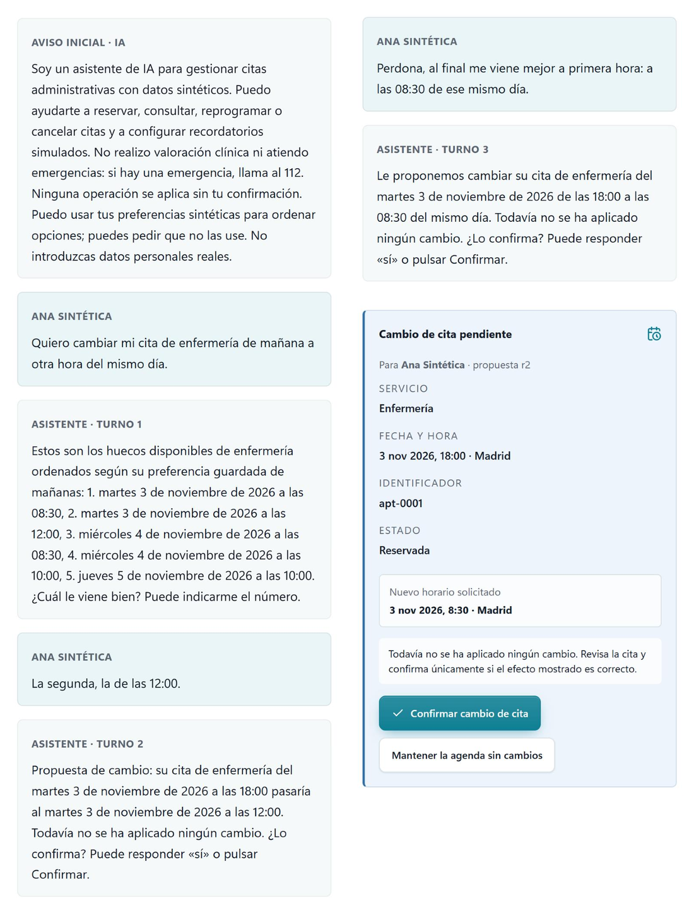

# CitaLab

[](https://github.com/Andros5/citalab/actions/workflows/ci.yml)
[](LICENSE)
[](#licencias)
[](requirements.txt)

Código, datos y resultados del Trabajo Fin de Máster **Agentic AI para personalización
conversacional en entornos regulados**, del Máster Universitario en Lógica, Computación e
Inteligencia Artificial de la Universidad de Sevilla.

- **Autor:** Andrés Rubio Ramos
- **Tutor:** José Francisco Quesada Moreno
- **Memoria:** [memoria/memoria-tfm.pdf](memoria/memoria-tfm.pdf)

CitaLab es un asistente conversacional para gestionar citas sanitarias **sintéticas**: consultar,
reservar, reprogramar, cancelar y configurar recordatorios simulados. El trabajo compara tres
arquitecturas que comparten las mismas herramientas y los mismos controles:

| Arquitectura | Qué decide el modelo de lenguaje |
|---|---|
| **M5** | Cinco agentes (contexto, cumplimiento, perfiles, orquestación y personalización) coordinados con LangGraph |
| **S1** | Un único agente que llama a las mismas herramientas |
| **H** | Solo interpreta la petición y redacta la respuesta. El flujo está programado |

Ninguna arquitectura puede saltarse el núcleo determinista: identidad, autorización por paciente,
uso del perfil limitado a cada finalidad, confirmación de una propuesta antes de cada escritura y
revalidación de reservas, cambios y cancelaciones sobre una agenda basada en un subconjunto de
FHIR R4.

<p align="center">
  
</p>

*Cambio de una cita en CitaLab (M5 con Gemini, datos sintéticos). El asistente ordena los huecos según
la preferencia guardada, prepara una propuesta, la rehace cuando la persona rectifica y no toca la
agenda hasta que se pulsa «Confirmar cambio de cita».*

## Resultados principales

La campaña final tiene 276 episodios completados: 46 condiciones con 3 arquitecturas y 2 modelos.
Los dos intentos que interrumpió la cuota diaria de Gemini se repitieron y no cuentan en las tasas.
Un episodio tiene éxito integral si produce exactamente el efecto pedido en la agenda, supera las
cuatro comprobaciones de seguridad y responde lo que debe (apartado 7.4 de la memoria).

| Modelo | Arquitectura | Éxito integral | Tokens por episodio (media) |
|---|---|---:|---:|
| GPT-OSS 20B (Groq) | M5 | 43/46 | 10 831 |
| GPT-OSS 20B (Groq) | S1 | 42/46 | 6 534 |
| GPT-OSS 20B (Groq) | H | 43/46 | 4 531 |
| Gemini 3.5 Flash-Lite | M5 | 43/46 | 8 286 |
| Gemini 3.5 Flash-Lite | S1 | 46/46 | 7 486 |
| Gemini 3.5 Flash-Lite | H | 43/46 | 3 447 |

- Ninguna diferencia de éxito entre arquitecturas es estadísticamente significativa.
- M5 hace el doble de llamadas que H y usa unas 2,4 veces sus tokens, sin mejorar el éxito ni la
  calidad de la conversación.
- Las comprobaciones de seguridad no detectaron ninguna escritura sin confirmación ni cambios en
  citas ajenas en los 276 episodios. Aun así, confirmar correctamente no garantiza cumplir la
  intención de la persona: en nueve episodios, una petición de cambio terminó en una reserva nueva.

La calidad de la conversación la puntúa un jurado de dos modelos (Claude Sonnet 5.5 y
GPT-6.1-Terra) en todos los episodios, contrastado con una revisión humana ciega de 60 episodios.
Todas las cifras de la memoria se recalculan con `python scripts/reproduce.py`.

## Contenido

```text
src/citalab/          asistente, núcleo determinista, agenda FHIR, evaluación y portal (código evaluado)
src/citalab_judge/    jurado LLM, revisión humana ciega y concordancia
scripts/              campaña, corpus, tablas de la memoria, correcciones y reproducción
tests/                pruebas automáticas, sin red
web/                  interfaz de CitaLab (React y TypeScript)
data/                 perfiles sintéticos y corpus de desarrollo y final
output/evaluation/final-independent-v1/
                      resultados, trazas, jurado, revisión humana y cifras derivadas
memoria/              memoria en PDF y sus fuentes LaTeX
docs/                 guía del código, diseño de la evaluación y guía de reproducción
```

## Instalación

Requisitos: Python 3.13 (versión de referencia, probada en Windows y Linux). Node.js 22 y pnpm
solo hacen falta para la interfaz, y Tectonic solo para compilar la memoria.

```bash
git clone https://github.com/Andros5/citalab.git
cd citalab
python -m venv .venv
source .venv/bin/activate        # Windows: .venv\Scripts\activate
pip install -r requirements.txt
pip install --no-deps -e .
```

## Reproducción

| Nivel | Qué permite | Qué necesita | Tiempo |
|---|---|---|---|
| 1. Consultar | Leer los resultados, las trazas, las evaluaciones y la memoria | Nada | |
| 2. Verificar | Comprobar que el código es el evaluado y regenerar todas las tablas | Python | 1 minuto |
| 3. Usar CitaLab | Explorar la campaña en la interfaz y conversar con M5, S1 y H | Node.js, y una clave de API para conversar | 10 minutos |
| 4. Repetir | Repetir la campaña, el jurado o la revisión humana | Claves de API y las CLI de los jueces | horas |

**Nivel 1.** Los resultados están en
[output/evaluation/final-independent-v1](output/evaluation/final-independent-v1),
con un README que describe cada fichero.

**Nivel 2.** Sin claves y sin llamar a ningún modelo:

```bash
python scripts/reproduce.py --tests
```

El comando comprueba con el manifiesto de la campaña que el código, el corpus y las instrucciones
de los agentes son exactamente los evaluados. Después regenera las tablas de los capítulos 8 y 9 y
el informe del jurado, los compara con los publicados y ejecuta las pruebas automáticas. La
integración continua lo repite en Linux y en Windows en cada cambio.

**Nivel 3.** La interfaz se compila una vez y el portal la sirve en http://127.0.0.1:8765:

```bash
cp .env.example .env             # añade GROQ_API_KEY o GEMINI_API_KEY
cd web && pnpm install --frozen-lockfile && pnpm build && cd ..
python -m citalab.portal.app
```

El primer arranque crea las cuentas de prueba y guarda sus códigos de acceso en
`output/portal/accesos-iniciales.txt`. Sin claves, el portal permite explorar la campaña final en
la pestaña de evaluación, con cada episodio y su transcripción. Las claves solo hacen falta para
conversar.

**Nivel 4.** [docs/reproduccion.md](docs/reproduccion.md) explica cómo repetir la campaña, el
jurado y la revisión humana, cuánto cuesta en llamadas y por qué los resultados de los modelos no
serán idénticos.

## Documentación

- [Guía del código](docs/guia-codigo.md): recorrido de una petición y mapa de módulos.
- [Evaluación](docs/evaluacion.md): corpus, oráculo, usuario simulado, jurado, revisión humana y
  análisis.
- [Reproducción](docs/reproduccion.md): niveles, salidas esperadas y repetición de la campaña.
- [Datos](data/README.md) y [resultados de la campaña](output/evaluation/final-independent-v1/README.md).

## Cómo citar

GitHub muestra la cita en formato APA y BibTeX en el botón **Cite this repository**, a partir de
[CITATION.cff](CITATION.cff).

## Licencias

- **Código:** MIT ([LICENSE](LICENSE)).
- **Datos, resultados y documentación:** [CC BY 4.0](https://creativecommons.org/licenses/by/4.0/deed.es).
- **Memoria:** [CC BY-NC-ND 4.0](https://creativecommons.org/licenses/by-nc-nd/4.0/deed.es). El
  logotipo de la Universidad de Sevilla pertenece a la universidad y no está incluido en ninguna
  de estas licencias.
- **Diagramas de arquitectura de la interfaz:** generados con Archify, con su licencia en
  [web/public/architecture/LICENSE.txt](web/public/architecture/LICENSE.txt).

Todos los datos de pacientes, citas y perfiles son sintéticos.

## English summary

CitaLab is a conversational assistant for synthetic healthcare appointments, built for a master's
thesis at the University of Seville. It compares a five-agent architecture (M5), a single agent
(S1) and a programmed hybrid flow (H) that share the same deterministic safety core. The final
campaign has 276 episodes with GPT-OSS 20B and Gemini 3.5 Flash-Lite. No architecture is
significantly more successful, and M5 needs about 2.4 times the tokens of H. Run
`python scripts/reproduce.py --tests` to check that the published code is the evaluated code and
to regenerate every table of the thesis from the published results, without API keys.
